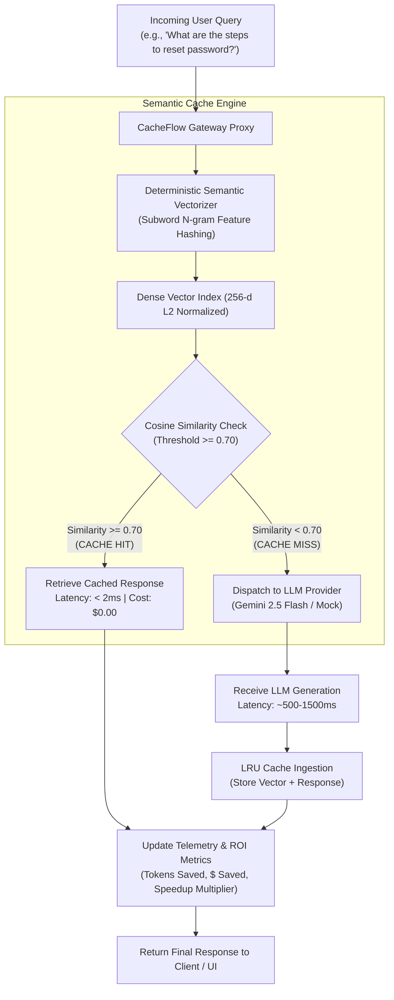

# ⚡ CacheFlow: Semantic Caching & LLM Cost Optimizer

[](https://www.python.org/downloads/)
[](https://docs.pydantic.dev/)
[](https://streamlit.io/)
[](https://pytest.org/)
[](LICENSE)

> **A high-performance semantic vector caching proxy for LLM applications. Drastically slashes API inference costs and drops query latency from seconds to sub-milliseconds using high-speed cosine vector similarity and LRU eviction.**

---

## 📌 Overview & Core Problem

In production conversational systems, search engines, and customer support bots, **up to 40% of incoming user queries are semantically repetitive** (e.g. *"How do I reset my password?"* vs. *"Steps to change my account password"*).

Calling an external LLM API for every semantically identical query introduces severe operational bottlenecks:
1. **Unnecessary Token Expenses:** Paying full input and output token fees on queries the model has already answered dozens of times.
2. **High Latency Bottlenecks:** External model inference typically takes 800ms to 2,500ms, creating sluggish user experiences.
3. **API Rate Limit Exhaustion:** Redundant queries consume strict organization rate limits during peak traffic bursts.

**CacheFlow** solves this by inserting an ultra-low-latency semantic vector cache in front of the model:
* **Vectorized Semantic Match:** Computes dense subword n-gram vector representations and evaluates cosine similarity against cached queries.
* **Instant Cache Hit (< 2ms):** If similarity exceeds the configurable threshold (default `0.70`), returns the verified cached answer at **$0.00 cost** and **< 2ms latency** (up to **1,000x faster**).
* **Transparent Fallback:** On cache misses, proxies the request to the LLM (Gemini 2.5 Flash / Mock), streams the result to the user, and indexes the generation for future reuse.

---

## 🏗️ System Architecture



---

## ⚡ Key Engineering Features

| Component | Technical Implementation | Performance & Scalability Value |
| :--- | :--- | :--- |
| **Deterministic Vectorizer** | L2-normalized subword n-gram and root-word feature hashing into fixed 256-dimensional space. | Eliminates expensive external embedding API calls; produces sub-millisecond query vectors. |
| **Vector Similarity Matcher** | Pure NumPy dot-product cosine similarity search with configurable thresholding. | Accurately matches paraphrased intent while rejecting unrelated topics. |
| **LRU Memory Eviction** | Deterministic Least-Recently-Used (LRU) eviction queue with configurable `max_entries`. | Keeps memory footprint bounded under heavy production throughput. |
| **Cost & Latency Telemetry** | Granular calculation of tokens conserved, cumulative dollars saved, and hit-ratio percentages. | Provides real-time visibility into infrastructure cost reductions. |
| **Zero-Crash Mock Provider** | Offline provider simulating realistic cloud latency and contextual SaaS answers. | Allows full local verification and automated testing without external API keys. |

---

## 🚀 Quickstart Guide

### 1. Clone & Set Up Virtual Environment
```bash
git clone https://github.com/afsalkp007/cache-flow.git
cd cache-flow

# Create and activate virtual environment
python3 -m venv .venv
source .venv/bin/activate

# Install dependencies
pip install -r requirements.txt
```

### 2. Configure Environment (Optional for Live Gemini API)
```bash
cp .env.example .env
# Paste your GEMINI_API_KEY if desired.
# If omitted, CacheFlow runs in offline mock mode.
```

---

## 🌐 Interactive Streamlit Web Application

Launch the real-time semantic cache dashboard:
```bash
streamlit run cache_flow/app.py
```

* **Live Query Playground:** Test paired questions to observe cold-cache misses transitioning into instant warm-cache hits.
* **Real-Time ROI Metrics:** Live telemetry showing Hit Ratio %, Speedup Multiplier (e.g., `1,200x`), Tokens Saved, and Dollars Saved.
* **Vector Store Inspector:** Inspect all cached queries, token counts, hit counters, and last-accessed timestamps.
* **Dynamic Threshold Tuning:** Adjust the similarity slider in real time to balance hit rates against semantic precision.

---

## 🧪 Test Suite

Run the full automated test suite (14 unit tests covering Pydantic models, vector normalization, cosine similarity, semantic hits/misses, LRU eviction, and proxy telemetry):
```bash
pytest -v
```

```text
======================== 14 passed in 1.52s =========================
```

---

## 📂 Repository Structure

```text
cache-flow/
├── .env.example              # Environment variables template
├── .gitignore                # Git ignore rules (secrets, venv, caches)
├── LICENSE                   # MIT License
├── README.md                 # Technical documentation
├── pyproject.toml            # Project packaging specification
├── requirements.txt          # Python dependencies
├── cache_flow/               # Core application package
│   ├── __init__.py           # Package version definition
│   ├── app.py                # Streamlit semantic cache dashboard
│   ├── cache.py              # In-memory semantic vector cache with LRU
│   ├── embeddings.py         # Subword n-gram vectorizer & cosine similarity
│   ├── gateway.py            # Proxy gateway with cost/latency telemetry
│   └── models.py             # Pydantic schemas and metrics models
└── tests/                    # Automated unit tests (14/14 passed)
    ├── test_cache.py
    ├── test_embeddings.py
    ├── test_gateway.py
    └── test_models.py
```

---

## 👤 Author & License

* **Author:** Afsal ([afsalkp.mohammed@gmail.com](mailto:afsalkp.mohammed@gmail.com))
* **License:** [MIT License](LICENSE)
